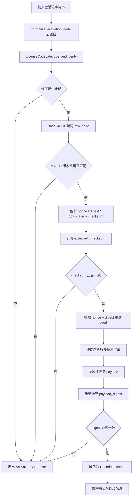
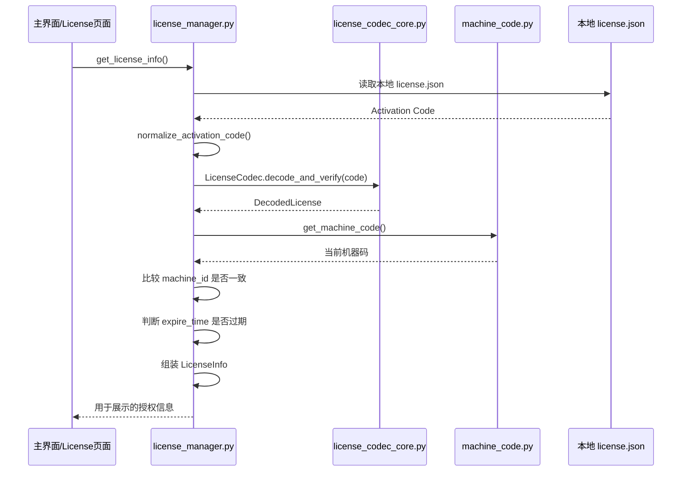
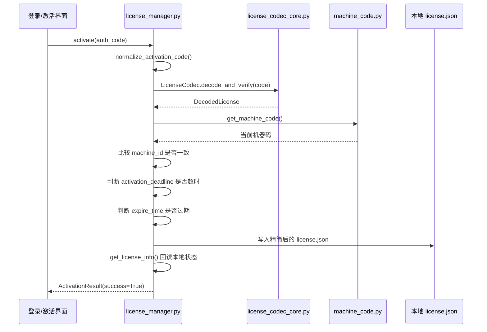

# 激活码校验流程说明

本文档用于帮助后续维护者快速理解当前程序端的激活码校验链路、职责分层，以及与生成器端需要保持一致的核心规则。

---

## 1. 当前职责分层

### 1.1 `app/common/utils/license_codec_core.py`

这是**纯编解码核心层**，只负责：

- 激活码字符串的编码与解码
- payload 打包/解包
- seed 计算
- 字节置换
- 多轮混淆/反混淆
- checksum 校验
- Base64URL 编码/解码

它**不负责**：

- 当前机器码获取
- 本地 `license.json` 读写
- 授权是否已过期
- 激活时间是否失效
- 机器码是否匹配

### 1.2 `app/common/utils/license_manager.py`

这是**授权业务层**，负责：

- 读取/写入本地 `license.json`
- 获取当前机器码
- 调用 `decode_activation_code()` 做底层激活码解析
- 判断机器码匹配
- 判断激活时间是否失效
- 判断授权是否过期
- 把结果整理成界面展示需要的 `LicenseInfo`

---

## 2. 程序端激活码校验涉及的主要入口

### 2.1 程序启动时

入口：`main.py`

- 调用：`is_activated()`
- 内部继续走：`get_license_info()`
- 最终落到：`decode_activation_code()` -> `LicenseCodec.decode_and_verify()`

用途：

- 判断本地是否已经存在有效授权
- 若无效，则弹出激活流程

### 2.2 用户手动输入激活码时

入口：`app/modules/login/view/login_view.py`

- 调用：`activate(auth_code)`
- 最终落到：`decode_activation_code()` -> `LicenseCodec.decode_and_verify()`

用途：

- 完成一次真正的“激活”动作
- 校验通过后写入本地 `license.json`

### 2.3 在软件设置/License 页面查看授权状态时

入口：

- `app/modules/app_config/view/license_info_page.py`
- `app/presentation/controller/main_window_controller.py`

调用：

- `get_license_info()`

用途：

- 展示当前授权是否有效
- 展示 Machine ID / 过期时间 / 剩余天数 / Activation Code

### 2.4 校验工具中解析激活码时

入口：`tools/gen_activation_code_gui.py`

调用：

- `decode_activation_code()`

用途：

- 只做解析与校验
- 不写入本地授权文件

---

## 3. 激活码底层校验流程图

---

## 4. 程序端“查看授权状态”时序图

---

## 5. 程序端“手动激活”时序图

---

## 6. 生成器端与程序端必须完全一致的部分

这部分全部位于：`app/common/utils/license_codec_core.py`

生成器端若要保持完全一致，必须复用或逐项同步以下内容：

- `MAGIC`
- `NONCE_SIZE`
- `PAYLOAD_DIGEST_SIZE`
- `CHECKSUM_SIZE`
- `PAYLOAD_SIZE`
- `ROUND_COUNT`
- `HEADER_STRUCT`
- 文本字段长度常量
- `_pack_payload()`
- `_payload_digest()`
- `_build_seed()`
- `_make_permutation()`
- `_encode_round()`
- `_decode_round()`
- `_calc_checksum()`
- `LicenseCodec.generate()`
- `LicenseCodec.decode_and_verify()`

如果两端有任何一个细节不一致，都会导致：

- 长度错误
- checksum 校验失败
- digest 不一致
- payload 解包失败

---

## 7. 当前业务层真正做了哪些“授权判断”

位于：`app/common/utils/license_manager.py`

### 7.1 `get_license_info()`

用于“查看当前授权状态”，核心步骤：

1. 读取 `license.json`
2. 解码激活码
3. 获取当前机器码
4. 校验 `decoded.machine_id == current_machine`
5. 校验 `now <= decoded.expire_time`
6. 输出 `LicenseInfo`

### 7.2 `activate()`

用于“用户提交激活码”，核心步骤：

1. 解码激活码
2. 获取当前机器码
3. 校验机器码匹配
4. 校验 `now <= decoded.activation_deadline`
5. 校验 `now <= decoded.expire_time`
6. 写入本地授权文件

---

## 8. 本地持久化文件说明

本地文件路径由：`get_app_config_path()` 决定，当前授权文件为：

- `license.json`

当前只保存以下界面展示字段：

- `激活状态:`
- `Machine ID:`
- `过期时间:`
- `剩余时间:`
- `Activation Code:`

这样做的目的：

- 减少本地暴露的详细授权信息
- 避免直接从本地 JSON 还原更多内部规则字段

---

## 9. 维护建议

### 建议 1
生成器端优先直接复用 `license_codec_core.py`，不要手工再写一版。

### 建议 2
若后续协议有变动，请升级 `MAGIC`（例如 `ACG3`），避免新旧规则混用。

### 建议 3
后续若继续维护，请始终牢记：

- `license_codec_core.py` = 编解码协议层
- `license_manager.py` = 授权业务层

这两个职责不要混在一起。

